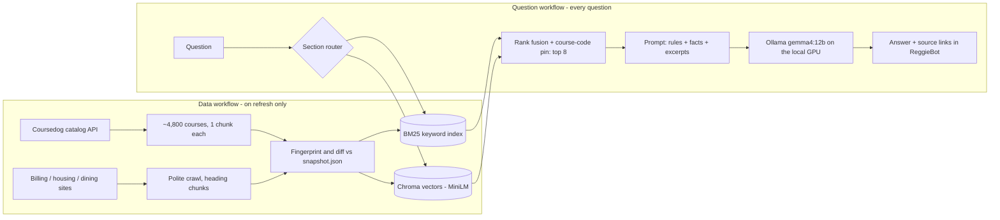
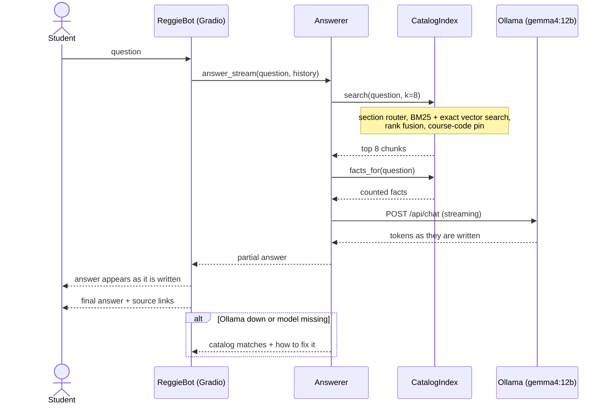

# ReggieBot: ISU Campus Assistant

ReggieBot is a chatbot I built that answers questions about Illinois State University **courses, billing, housing and
dining**. It's a RAG (retrieval-augmented generation) assistant, which means it doesn't answer from general knowledge.
It searches ISU's own course catalog and websites, hands the best matches to an AI model, and the model writes an
answer using only those pages. Every answer has links to the sources it used, so you can check it.

The main version writes its answers with **Gemma 4 12B running on my own computer through
[Ollama](https://ollama.com)**, so there's no API key, no quota and no cost per question. There's also a version on a
Hugging Face Space, an Android app called **Campus Assistant ISU (unofficial)**, and an RLHF notebook that learns which
kind of answer I like better.

> **Disclaimer:** this is a student project. It is not made by, endorsed by, or affiliated with Illinois State
> University. The answers come from an AI model and they can be wrong, so double check anything important (like
> deadlines or costs) with the university.

## Contents

1. [All the versions](#all-the-versions)
2. [Clone and run](#clone-and-run)
3. [How it works](#how-it-works)
4. [Features](#features)
5. [Where it won't answer](#where-it-wont-answer)
6. [Evaluation, cost, reliability and speed](#evaluation-cost-reliability-and-speed)
7. [Sharing with 5–15 people](#sharing-with-515-people)
8. [What changed: Gemini to Ollama (October 14–28)](#what-changed-gemini-to-ollama-october-1428)
9. [The Hugging Face Space version](#the-hugging-face-space-version)
10. [Exact search and cleanups (November 5–6)](#exact-search-and-cleanups-november-56)
11. [The RLHF notebook (November 5–6)](#the-rlhf-notebook-november-56)
12. [The Android app (November 13)](#the-android-app-november-13)
13. [Daily limit test (November 16)](#daily-limit-test-november-16)
14. [Known issues and next steps](#known-issues-and-next-steps)
15. [Running each version](#running-each-version)
16. [Repository layout](#repository-layout)

---

## All the versions

| Notebook | What it is | Status |
|---|---|---|
| `ISU-CampusAssistant-RAG-Ollama.ipynb` | **The main program.** It answers with Gemma 4 running on my computer through Ollama | Main version |
| `ISU-CampusAssistant-RAG-Demo.ipynb` | The original version, which answers with Google Gemini (needs `GOOGLE_API_KEY`) | Unchanged |
| `ISU-CampusAssistant-RAG-Space.ipynb` | The same program on a Hugging Face Space with ZeroGPU, so it has a permanent public address | Added in October |
| `ISU-CampusAssistant-Android.ipynb` | Builds the Android app and the Space it talks to | Added in November |
| `ISU-CampusAssistant-RLHF.ipynb` | Learns whether I prefer short or detailed answers and uses that to pick between two answers | Added in November |
| `ISU-CampusAssistant-Compare.ipynb` | Gemini vs Ollama on the same 50 questions, with blind grading | Small updates so it keeps working |

All of them use the same code in the `reggiebot/` package and the same saved data in `isu_catalog_cache/`. The only
real difference between them is how the model plugs in.

---

## Clone and run

### What you need

| | |
|---|---|
| Computer | Windows 10/11 (tested), macOS or Linux |
| GPU | NVIDIA with 10–12 GB of memory recommended (I tested on an RTX 4070 Ti, 12 GB). It still runs without one, just slowly |
| Disk | About 15 GB free: the model is 8 GB, and the Python packages (mostly PyTorch) are most of the rest |
| Software | [Python 3.10+](https://www.python.org/downloads/) (tested on 3.12), [Git](https://git-scm.com/downloads), [VS Code](https://code.visualstudio.com/) with the **Python** and **Jupyter** extensions, [Ollama](https://ollama.com/download) |

### Steps

1. **Clone the repo** and open the folder in VS Code.
   ```bash
   git clone <this-repo-url>
   cd <repo-folder>
   ```
2. **Make a virtual environment and install the packages** (in VS Code's terminal):
   ```bash
   python -m venv .venv
   .venv\Scripts\activate          # Windows
   source .venv/bin/activate       # macOS / Linux
   pip install -r requirements.txt
   ```
3. **Install Ollama and download the model.** Install Ollama from [ollama.com/download](https://ollama.com/download)
   and start it (you'll see a llama icon in the system tray). Then, in a new terminal:
   ```bash
   ollama pull gemma4:12b
   ollama run gemma4:12b "Say ready"
   ```
   If the second command answers, Ollama is working. The notebook sets the context length itself, so there's nothing
   else to set up in Ollama.
4. **API keys: none needed** for the Ollama version. You can copy `.env.example` to `.env` for optional settings. Never
   commit `.env` (`.gitignore` already leaves it out).
5. **Open `ISU-CampusAssistant-RAG-Ollama.ipynb`** and pick the `.venv` interpreter as the kernel (top right of the
   notebook).
6. **Run All.** The first run crawls the ISU catalog and websites and builds the search index, which takes about two
   minutes, because the saved data isn't in the repo. After that, untick `REFRESH_DATA` in section 9 and the app
   starts from the saved data in a few seconds. The chat opens at **http://127.0.0.1:7860**.
7. **Optional:** share it with 5–15 people (see [Sharing](#sharing-with-515-people)).

**No good GPU?** Pull a smaller model (`ollama pull qwen3.5:4b`) and set `OLLAMA_MODEL = "qwen3.5:4b"` in
`reggiebot/config.py`. Answers come back faster on weaker hardware, but the quality drops a little.

**No Ollama at all?** Double-click `start_test_mode.bat`. It uses a fake model that answers instantly with no AI, so
you can still try the search, source links and chat page.

### If something goes wrong

| Problem | Fix |
|---|---|
| `ollama` is "not recognized" in the terminal | Close and reopen VS Code completely after installing Ollama |
| Chat says **"Ollama is not running"** | Start the Ollama app. The next question reconnects on its own |
| Chat says **"The model is not downloaded"** | `ollama pull gemma4:12b` |
| "No saved data … Run the crawler cell first" | Tick `REFRESH_DATA` in section 9 and run that cell |
| Answers are slow | Run the **Troubleshooting Ollama** cell (`ollama_report()`). It shows whether the model is fully on the GPU |
| Every answer takes ~2 s longer than it should | Keep `OLLAMA_URL` as `http://127.0.0.1:11434`. On Windows, `localhost` tries IPv6 first |
| Windows says "the paging file is too small" (RLHF notebook) | Close other heavy programs or make the page file bigger |

---

## How it works





Here's the short version:

1. **Collect.** It pulls all ~4,800 courses from the catalog's Coursedog JSON API and crawls the billing, housing and
   dining sites. The crawl follows `robots.txt`, stays on an allowlist of ISU sites, and waits between requests.
2. **Sync.** Every course gets a fingerprint, so each refresh reports what was **added / removed / updated** and only
   re-embeds what changed.
3. **Index.** Each course is one chunk. Web pages get split on their headings into ~1,000-character chunks. Everything
   gets embedded with MiniLM and stored in **Chroma**, along with a BM25 keyword index.
4. **Search.** BM25 handles exact words like "IT 214". The vector search handles vague questions like "classes about
   teaching kids to read". The two rankings get combined with reciprocal rank fusion. If the question has a real
   course code in it, that course gets pinned to the top.
5. **Answer.** Gemma 4 gets the top 8 chunks and a prompt that tells it to only use those and to say so when the answer
   isn't there. The answer streams back into the chat with source links under it.

The notebook's **Design** section has the full write-up: which components are **pre-determined** (they touch every
question) and which are **probabilistic** (only in certain situations), a cell that traces the route of any question,
the architecture diagram, the feature lists and the edge cases.

### Components at a glance

| Pre-determined (every question) | Probabilistic (only when triggered) |
|---|---|
| Gradio chat · BM25 search · MiniLM + exact vector search · rank fusion (top 8) · prompt builder · Ollama · source links | Section router (billing/housing/dining words) · course-code pin (a real code in the question) · counted facts (a subject code) · conversation history (follow-ups) · retry (timeout) · catalog-matches fallback (Ollama down) · reconnect · TF-IDF search (MiniLM unavailable) · crawler (refresh only) |

---

## Features

**Must-have (delivered)**

1. Grounded answers about ISU courses, billing, housing and dining, using only ISU's own data
2. Hybrid retrieval: BM25 + vector search, rank fusion, course-code pin, section router
3. Source links under every answer
4. It says so instead of making things up (missing courses, data behind a login, off-topic questions)
5. Free, local generation with Ollama: no key and no quota
6. It keeps working when parts break: cached data when the network is down, catalog matches when Ollama is down
7. Change detection: added / removed / updated courses, and it only re-indexes what changed
8. ReggieBot chat in Illinois State colors, with starter questions
9. Built-in evaluation: retrieval and answer metrics, manual grading, and a speed and cost report
10. Limited public sharing: a link, a waiting line and an anonymous usage count

**Top 3 nice-to-have**

1. Thumbs up / down feedback in the chat, saved for evaluation
2. A prerequisite planner that can reason through prerequisite chains
3. Always-on hosting with a nightly refresh

---

## Where it won't answer

Courses that don't exist, anything behind a login (balances, housing assignments, grades), live registration data
(open seats, times, instructors), future or unpublished prices, off-topic questions, prerequisite-chain reasoning, and
pages that were never crawled. In each case it says so instead of guessing. The notebook's **Edge cases** table lists
all 15 scenarios, and a cell runs 7 of them.

---

## Evaluation, cost, reliability and speed

The output gets evaluated in three layers (notebook section 13):

1. **Retrieval:** did the right source actually reach the model?
2. **Automatic answer checks:** did it answer, cite the expected source, link websites, and decline the trap questions?
3. **Manual grading:** is the answer actually correct? Only a person can tell a wrong answer that sounds good from a
   right one.

Speed and cost are measured in section 14.

These were measured on October 19, 2026 with `gemma4:12b` on an RTX 4070 Ti, over the 50 Arm 1 questions (10
course-code, 10 course-topic, 8 billing, 8 housing, 8 dining, 6 trap). After the exact search change on November 6,
I re-ran them and the scores were the same.

| Reliability | Result |
|---|---|
| Right source in the 8 chunks given to the model | 44/44 (100%) |
| Right source in the 5 source cards a user sees | 43/44 (98%), MRR 0.93 |
| Billing / housing / dining questions sent to their own section | 20/24 (83%) |
| Model wrote an answer (no fallback) | 50/50 (100%) |
| Answer names the expected course or links the expected site | 44/44 (100%) |
| Website answers that include a source link | 24/24 (100%) |
| Trap questions declined instead of answered | 6/6 (100%) |
| Manual grading (correct / partial / wrong) | Still need to do it (section 13) |

| Speed (10-question sample) | Median | 90th percentile |
|---|---|---|
| Time to first token (search included) | 0.9 s | 1.0 s |
| Full answer | 2.2 s | 4.0 s |
| Search (BM25 + vectors) | 0.04 s | |
| Generation speed | 132 tokens/s | |

| Cost | |
|---|---|
| API | $0: no key, no quota |
| Electricity (upper estimate: 285 W for the whole answer at $0.16/kWh) | about $0.00003 per answer, or $0.03 per 1,000 answers |
| Hardware | You need a decent GPU for these speeds. That's the real cost of running it locally |

The automatic checks are just text matches, so they catch missing sources but not wrong facts. The manual grades are
what really decide if an answer is correct. Raw results are in `isu_catalog_cache/experiments/arm1_ollama/` and
`performance_ollama.json`. `ISU-CampusAssistant-Compare.ipynb` runs the same questions through Gemini too, with blind
grading.

---

## Sharing with 5–15 people

1. In `reggiebot/config.py`, set `SHARE_LINK = True` and restart the kernel. Or skip the notebook and double-click
   `share_reggiebot.bat`.
2. Run All. Section 10 prints a public `https://….gradio.live` link. Send that to your testers. You get a new link
   every time it starts.
3. There's no login. I added one at one point but ended up taking it out, so anyone with the link can use the app.
   Only share it with the people you want using it.
4. Keep the PC, Ollama and the notebook running. One answer gets written at a time (`MAX_CONCURRENT = 1`) and up to 20
   people can wait in line (`MAX_QUEUE`). With answers taking around 2 s, if 15 people ask at the same time the worst
   wait is about 30 seconds.
5. Section 15's `usage_summary()` counts questions and browser sessions from
   `isu_catalog_cache/experiments/usage_log.csv`. It never saves what was typed.

---

## What changed: Gemini to Ollama (October 14–28)

### 1. Answers come from a local model instead of Gemini

**Why:** Gemini's free tier has daily and per-minute limits, so the app could run out of answers.

- The answers are now written by **`gemma4:12b` running in Ollama on my PC**. The prompt, the search and the source
  links are all the same as the Gemini version. The only thing that changed is the model.
- Settings: `OLLAMA_MODEL = "gemma4:12b"`, `OLLAMA_CONTEXT = 8192` tokens (Ollama's default can be too small, and it
  cuts the prompt off without telling you), `OLLAMA_KEEP_ALIVE = "30m"` and `OLLAMA_TIMEOUT = 300` s. I turned
  "thinking" off so the model just answers directly. Temperature is still 0.2.
- If Ollama isn't running or the model isn't downloaded, the chat shows the matching catalog entries with a short
  explanation instead of an error. Once Ollama is back, it reconnects by itself.
- `ollama_report()` replaces `gemini_report()`. It checks that Ollama is running, that the model is downloaded, that it
  actually answers, and how much of it fits in GPU memory.
- Experiment results get saved to `experiments/arm1_ollama/`, so they never overwrite the Gemini results.

### 2. The project write-up is inside the notebook

| Requirement | Where in the notebook |
|---|---|
| Components: pre-determined vs probabilistic routes | **Design** section: a table of 17 components, plus `route_trace()`, which shows which components a question triggers |
| Workflow and sequence diagrams | **Design** section |
| Architecture diagram | **Design** section, with a table of what each class does |
| Must-have features and top 3 nice-to-have features | **Design** section |
| Edge cases where it won't answer | **Design** section: 15 scenarios, plus a cell that runs 7 of them |
| How output is evaluated | **§13**: retrieval scores, automatic answer checks, and then manual grading |
| Cost, reliability and speed | **§14**: times the answers and estimates the electricity cost |
| Sharing with 5–15 people | **§15**: public link, a waiting line and an anonymous usage count |

While doing this I found and fixed two problems with the evaluation:

- **The trap question check was undercounting.** Answers that said "do not contain" weren't being counted as
  declining. After the fix, the score went from 3/6 to 6/6, which matches what the answers actually say.
- **Time to first token** now gets measured on every answer, along with the full answer time.

### 3. A speed fix: about 2 seconds saved on every answer

Ollama's own timings showed the model only needed under half a second, but answers were taking about 3 seconds to
start. The problem was the address `localhost`. On Windows it tries IPv6 first, which Ollama doesn't listen on, and
then waits about 2 seconds before falling back. I changed the setting to `OLLAMA_URL = "http://127.0.0.1:11434"`.

| | Before | After |
|---|---|---|
| Time to first token (median) | 3.1 s | **0.9 s** |
| Full answer (median) | 4.6 s | **2.2 s** |

The answers and scores didn't change.

### 4. The code moved into a Python package

Having one notebook with about 1,800 lines of code made it hard to change things safely, and two other files had to
dig code out of its cells. All the code is now in `reggiebot/`, with one file for each stage:

| File | Notebook section | What it does |
|---|---|---|
| `config.py` | §1 | Every setting: model, `TOP_K`, sites to crawl, paths, sharing |
| `collect.py` | §2–§4 | Catalog API, website crawler, chunking, change detection |
| `index.py` | §5 | Hybrid search: BM25 + MiniLM vectors, rank fusion, course-code pin, section router |
| `answer.py` | §6 | The prompt, the model interface, streaming, retries, fallbacks |
| `core.py` | §7 | `CatalogApp`: the data, the index and the answerer together |
| `ui.py` | §8 | The ReggieBot chat page |

The crawler, the launch and all of the evaluation are still in the notebook. **If you want to change a setting**, edit
`reggiebot/config.py` and restart the kernel. **If you want to change code**, edit the `.py` file and re-run the cell.
`autoreload` picks it up.

### 5. A model interface, and a fake model for testing

- The answerer talks to any model through three methods: `check()`, `warm_up()` and `generate(system, prompt)`.
- `OllamaModel` is the real model. `FakeModel` answers instantly with no AI and just lists what the search found, so
  the search, source links and chat page can be tried on any computer.
- The fake model can also pretend to fail (`fake:offline`, `fake:missing`, `fake:busy`, `fake:broken`) so you can see
  the fallback messages and retries.
- You can switch with `MODEL` in `config.py`, `python app.py --fake`, or `start_test_mode.bat`.

### 6. Answers come back as one result

Before this, the code that called the answerer had to guess what happened from the first few words of the text, and
timing was saved on a shared object, so two answers at the same time could mix it up. `answer()` now returns an
`Answer` with `.text`, `.hits`, `.status`, `.timing`, `.model` and `.retries`. The status is one of `answered`,
`partial`, `no_matches`, `offline`, `missing`, `busy` or `rejected`. Everything that reads results uses it directly, so
rewording a message can't mess up the counts anymore.

### 7. Running it without VS Code

- `app.py` starts and stops the app from a terminal. While it's running it keeps the PC awake, and when it stops it
  frees up the graphics card.
- Double-click files: `start_reggiebot.bat`, `share_reggiebot.bat`, `start_test_mode.bat` and `stop_reggiebot.bat`.
- Options: `--share` (public link), `--hours 3` (stops by itself), `--refresh` (re-crawl first) and `--status`.

---

## The Hugging Face Space version

A Hugging Face Space gives ReggieBot a **permanent public address** that still works when my PC is off. The free shared
GPU it uses (ZeroGPU) can't run Ollama, so the model gets loaded inside the app with `transformers` instead.

**Live Space:** https://huggingface.co/spaces/JakoBob/Campus_Assistant

| File | What it does |
|---|---|
| `ISU-CampusAssistant-RAG-Space.ipynb` | Explains the Space version, tests it, builds the upload folder and uploads it |
| `space_app.py` | The Space's entry point: loads Gemma 4 when it starts and answers inside `@spaces.GPU` |
| `reggiebot/hf_model.py` | `TransformersModel`, the transformers version of the model interface |
| `space_build/` | Made by the notebook (75 MB). It's exactly what gets uploaded. Git ignores it |

### The notebook's sections

| Section | What it does |
|---|---|
| Settings | Model (`google/gemma-4-12B-it`), the tiny local test model, GPU seconds per answer, Space name |
| §1 Try it on this computer | Runs the whole program with a tiny model (SmolLM2-135M) on the CPU to check that everything connects. The answers are bad, but that's expected |
| §2 Check Gemma 4's prompt | Downloads only Gemma 4's settings and tokenizer and shows the exact prompt it will read |
| §3 Build the Space folder | Copies the code, the saved data and the settings into `space_build/` |
| §4 Upload | Creates the Space, sets the model, asks for ZeroGPU and uploads (off until you tick `UPLOAD_SPACE`) |
| §5 Once it's running | What to check, speed, and how to update or stop it |

### Problems I ran into while deploying

| Problem | Fix |
|---|---|
| After I moved the notebook into a subfolder: `No module named 'reggiebot'` | The notebook and `space_app.py` now search upward for the folder that has `reggiebot/` in it |
| Upload refused: `"short_description" length must be less than or equal to 60 characters` | Shortened it to "Student RAG assistant for ISU courses and campus info" |
| The upload kept failing even after that fix | VS Code was running an old copy of the notebook from memory. Closing its tab without saving and reopening it fixed it |
| Every answer failed on the Space: `RuntimeError: No CUDA GPUs are available` | The search was running MiniLM with PyTorch in the Space's main process, which stops ZeroGPU's GPU workers from finding the GPU. The search now uses the same MiniLM model through onnxruntime. I checked first, and it gave identical results on all 50 Arm 1 questions |
| Gemma 4's full processor needs torchvision | ReggieBot only sends text, so it falls back to the tokenizer, which has the same chat template |
| The fallback messages mentioned Ollama, which doesn't exist on the Space | The Space has its own wording ("The model is busy, or today's free GPU time has run out") |

### How the two compare

| | Ollama version | Space version |
|---|---|---|
| Model | `gemma4:12b`, compressed (~8 GB) | `google/gemma-4-12B-it`, full bfloat16 (~24 GB) |
| Runs on | my RTX 4070 Ti | ZeroGPU: a GPU borrowed for each answer |
| Address | a new `gradio.live` link every time it starts | permanent |
| Answer time | about 2 s | about 9–13 s, mostly waiting for a GPU to be assigned |
| Limits | none | about 3 answers a day for someone who isn't logged in (see the [daily limit test](#daily-limit-test-november-16)) |

I checked it on the live Space. "What are the prerequisites for IT 214?" gave "COM 110 and ENG 101" with the course
link, and "What is my current account balance?" got declined like it should, with links to the billing pages.

---

## Exact search and cleanups (November 5–6)

### Exact vector search, behind one small wrapper

**The problem:** every chunk of ISU information (6,783 of them) is stored as a list of numbers, and a question gets
matched to the chunks whose numbers are closest. Chroma, the database that stores those numbers, also did the
searching, and its search takes shortcuts to be fast. The shortcuts could come out differently each time the program
started, so the same question could get different chunks. On one start that happened for **14 of the 50** test
questions, which made test results change from run to run.

**What I changed:**

- Chroma still **stores** the numbers, and still only updates the chunks that changed.
- ReggieBot now **searches** them itself by checking every chunk, with no shortcuts. That's one matrix multiplication
  over 6,783 × 384 numbers, which takes a few milliseconds.
- All the code that talks to Chroma is now in one class, `VectorStore` (`reggiebot/index.py`). If I switch databases
  later, that's the only thing I have to change.

**How I checked it:** I ran the 50 Arm 1 questions three times, each in a fresh start, and all three runs gave
identical chunks. The scores didn't change (44/44 in the top 8, 43/44 in the top 5, MRR 0.93, routing 20/24), and
every scored question kept its right source at the same rank as on October 19.

### Four small cleanups

| Cleanup | Before | After |
|---|---|---|
| **Source links** | The chat decided whether to add links by checking how a message started | It uses the answer's status, so links only get added when the model actually wrote the answer |
| **One Answerer** | Loading or refreshing data built a new Answerer when the model wasn't ready, which could swap out the model I picked (like the fake one) | One Answerer is kept and just re-checked (`ready_answerer()` in `core.py`) |
| **Usage log** | `usage_log.csv` saved time, session, status and speed | It also saves `retries` and `model`. An older log gets the new columns automatically, blank for old rows |
| **The "THE" bug** | "the" was read as the theatre subject code THE, and pieces of words like "deposit" were read as IT, which added wrong course counts to the prompt | Subject codes have to be whole words, and the ones that are everyday words (BE, BUS, HIS, IT, THE) only count in capitals |

The wrong course counts are gone from 14 of 55 test questions, and real ones like "IT 214" still get theirs.

### Tests

There are now **35 tests**, up from 15. Run them from the project folder:

```
python -m unittest discover tests -v
```

| File | What it checks |
|---|---|
| `tests/test_answerer.py` | Answers, statuses, retries, fallbacks and source links, using the fake model |
| `tests/test_index.py` | The exact search (order, section filter, ties, empty cases) and which subject codes a question names |
| `tests/test_app.py` | One Answerer kept across loads, and the usage log (written to a temporary folder) |

---

## The RLHF notebook (November 5–6)

`ISU-CampusAssistant-RLHF.ipynb` learns which kind of answer I like better, short or detailed, and uses that to choose
between two answers.

```
ReggieBot's search  →  the same 8 excerpts  →  two Gemma 4 answers  →  I pick one  →  a small reward model learns my preference
                                                A: short and simple
                                                B: explains more
```

RLHF (reinforcement learning from human feedback) usually has two stages. First a **reward model** learns what people
prefer, and then the main model gets retrained using that reward. This notebook does the **first stage**. It follows
the IT244 reward-head notebook, adapted to ReggieBot.

Both answers only use ReggieBot's own saved data (the catalog and the billing, housing and dining pages) and the chat
app's own prompt rules. A and B get **exactly the same 8 excerpts and the same prompt**. The only difference is one
extra line that sets the style:

| | Style | Instruction |
|---|---|---|
| **A** | Short and simple | One or two plain sentences, under 50 words, no lists |
| **B** | Explains more | About 120–200 words: the direct answer first, then details from the sources |

So when I pick one, I'm picking how the answer is written, not what information it got.

### The notebook's sections

| Section | What it does |
|---|---|
| §1 Setup | Loads ReggieBot's saved data (no crawling) and checks that Gemma 4 is ready in Ollama |
| §2 Two answers | `retrieve()` runs ReggieBot's search, and `write()` asks Gemma 4 for each style. Retries once if Ollama's model runner restarts |
| §3 Collect preferences | A small app: pick a question, press **Generate A / B**, then **Prefer A**, **Prefer B** or **Neither** |
| §4 Encoder | Loads the small frozen model the reward head reads (Qwen2.5-0.5B, on the CPU) |
| §5 Train | Trains the reward head on my choices and writes a report |
| §6 Use it | Best-of-2: for a new question, it writes both styles, scores them, and shows the one with the higher score |

### How the reward model works

- **The input:** the question + evidence + one answer, read by **Qwen2.5-0.5B-Instruct**, which stays frozen. It turns
  that into one vector of 896 numbers. The evidence is included so the head can learn whether an answer fits the
  sources, not just how it reads.
- **Why Qwen and not Gemma 4:** this Ollama version can't hand out Gemma 4's internal features. A separate, small
  reward model is the normal RLHF setup anyway.
- **What learns:** one linear layer with **896 weights** and no bias. It turns the vector into one score.
- **The loss:** Bradley–Terry, `-log(sigmoid(score_chosen − score_rejected))`, which pushes the chosen answer's score
  above the rejected one.
- **Training settings:** AdamW, learning rate 0.01, weight decay 0.01, 100 epochs, seed 7. These are fixed, not tuned
  on the held-out questions.
- **Held-out questions:** each question goes into `train` or `heldout` based on its wording (about 1 in 4 is held out)
  before any answers are shown, and held-out pairs never get used for training.
- **A baseline to beat:** A is always the short answer, so "always pick my favorite style" is an easy rule. The report
  shows that baseline next to the head.

### Results so far (November 6)

| Measure | Result |
|---|---|
| Preferences saved | 12: 9 training, 3 held-out |
| My choices | A (short) 10 times, B (explains more) 2 times |
| Agreement with my choices, training pairs | 100% |
| Agreement on held-out pairs, before training | 33% |
| Agreement on held-out pairs, after training | **100%** |
| Baseline "always pick short", held-out pairs | **100%** |
| Final training loss | 0.135 |

**What this means:** the head learned my training choices and matched all 3 held-out choices. But the simple rule
"always pick short" also got all 3 right, so right now I can't tell if it learned anything more than "this person
likes short answers." Three held-out questions is also way too few to prove anything. To really find out, I need more
ratings, especially on questions where the longer answer actually is better (like steps or requirements).

### Limits

- **Gemma 4 doesn't get retrained.** Best-of-2 changes which answer a user sees, not how Gemma 4 writes. Retraining it
  (for example LoRA with RLOO) would be the next stage.
- **A higher score doesn't mean a correct answer.** It just means "more like what this person picked."
- **A is always on the left and always short,** so position or length could affect my choices.
- **One rater, 12 ratings.** That's enough for a class experiment, but not enough to prove anything.

The files it saves (`preferences.jsonl`, `features.pt`, `reward-head.pt`, `reward-report.json`) are all in
`isu_catalog_cache/experiments/rlhf/`. The first run downloads the encoder (about 1 GB), and ReggieBot plus the encoder
use about 3 GB of RAM on top of what Ollama needs.

---

## The Android app (November 13)

I turned ReggieBot into an Android app called **Campus Assistant ISU (unofficial)** (on Google Play the title is
"Campus Asst. ISU (unofficial)" because of the 30-character limit). The phone app is really just the chat screen. All
the actual work happens on a Hugging Face Space, so my PC doesn't have to be on for the app to work.

```
 Android phone                        Hugging Face Space (ZeroGPU)                   private HF dataset
┌────────────────────────┐  HTTPS   ┌──────────────────────────────────────────┐   ┌──────────────────┐
│ Campus Assistant app   │ ───────▶ │ android_space_app.py                     │──▶│ reports/         │
│  chat, source links,   │   ask    │   endpoints: ask · report · status       │   │ usage_log.csv    │
│  Report button,        │ ◀─────── │ space_app.py: Gemma 4, the search, data  │   └──────────────────┘
│  About + privacy       │ streamed │ reggiebot/: the same package             │
└────────────────────────┘          └──────────────────────────────────────────┘
```

### What the app does

- **Chat.** You type a question or tap a starter question. The answer shows up as it's being written, and under it you
  get the list of pages it used.
- **Report this answer.** Google Play requires any app with AI generated content to let people flag offensive stuff
  without leaving the app. Reports go to a private dataset that only I can read.
- **Unofficial notice** on the chat screen and the About screen, with a link to the privacy policy.
- **No account, no ads, and nothing saved on the phone.** The conversation only lasts until you close the app.

### How it works

- The app is in `android_app/`, written in Kotlin with Jetpack Compose. You don't need Android Studio, everything gets
  built from `ISU-CampusAssistant-Android.ipynb`.
- The server is `android_space_app.py`, built on top of `space_app.py` and `reggiebot/`. It has three endpoints:
  `status`, `ask` (the question plus the last 4 turns of the conversation, streamed back about 3 times a second) and
  `report`.
- The server keeps an **anonymous usage log** (time, a random code, status, speed, retries and model, never the
  question) and the **reports**. Both get copied to a private dataset every 5 minutes and deleted within 12 months.
- The notebook writes the privacy policy (`PRIVACY.md`) based on what the app actually does.

### Testing

I tested it in an Android emulator (a virtual Pixel 7 with Android 16) on my PC. It answered course, billing and meal
plan questions with the right sources and correctly refused to look up an account balance. The emulator version talks
to a server on my PC that answers with Gemma 4 through Ollama, so the answers are real.

### Publishing

The notebook also builds the signed `.aab` for Google Play and writes the store listing materials (`listing.md`,
`data-safety.md`, `content-rating.md`, the icon and the feature graphic) into `android_app/store/`. The fastest way to
get it to people is Internal testing in the Play Console (up to 100 testers). Since it uses ISU's name, I need to check
with my instructor or ISU before publishing it publicly.

The full step-by-step setup is in `README-Android-app.md`.

---

## Daily limit test (November 16)

The Android app sends its questions to a free Hugging Face Space (`JakoBob/Campus_Assistant_App`). I wanted to find
out how many questions one person can get answered without being logged in to Hugging Face before the free GPU
allowance runs out.

**Result: 3 answers, and after that every question got refused.**

The test program (`isu_catalog_cache/experiments/app_daily_limit/daily_limit_test.py`) asks the Arm 1 questions in
order with no login and no pause, and stops after 3 questions in a row don't get answered.

| # | Question | Status | Total | What came back |
|---|---|---|---|---|
| 1 | C01: What are the prerequisites for IT 214? | **answered** | 15.0 s | "The prerequisites for IT 214 are COM 110 and ENG 101." |
| 2 | C02: What is IT 140 about? | **answered** | 11.5 s | A description of IT 140 |
| 3 | C03: How many credit hours is IT 150? | **answered** | 5.4 s | "IT 150 is 3 credit hours." |
| 4 | C04: What's the difference between IT 354 and IT 454? | busy | 2.1 s | The busy message and the catalog matches |
| 5 | C05: Describe TEC 283. | busy | 2.4 s | The busy message and the catalog matches |
| 6 | C06: What does CTK303 cover? | busy | 2.4 s | The busy message and the catalog matches |

The client only ever sees `busy`, so I got the actual reason from the Space's run log:

```
[transformers] google/gemma-4-12B-it attempt 1 (busy): TimeoutError: GPU not available:
'You have exceeded your ZeroGPU runs limit. Authenticate with a Hugging Face token for more quota -
https://huggingface.co/settings/tokens'
```

So the limit is on the **number of GPU runs**, not seconds. The three answers only used about 31 seconds of server
time. The app's usage log from November 13–15 shows the same thing, and none of those days had more than 3 answers.

**What this means:** someone using the app gets about 3 written answers a day. After that they still get the catalog
matches, just not a written answer. The free Space is fine as a demo, but it can't really handle a lot of people. My
earlier estimate (about 2 minutes of GPU time, around a dozen questions) was wrong.

**What it doesn't show:** whether the limit is per connection or shared by everyone using the app, when it resets,
whether it's always 3, or what the limit is for logged-in users.

---

## Running each version

- **Ollama version:** start Ollama, open `ISU-CampusAssistant-RAG-Ollama.ipynb`, pick the `.venv` kernel, then
  **Run All**. Or just double-click `start_reggiebot.bat`.
- **Test mode (no Ollama):** double-click `start_test_mode.bat`.
- **Tests:** `python -m unittest discover tests -v` (35 tests, takes a few seconds).
- **Space version:** open `ISU-CampusAssistant-RAG-Space.ipynb` and run §1–§3. If you want to update the live Space,
  tick `UPLOAD_SPACE` and run §4.
- **Android app:** open `ISU-CampusAssistant-Android.ipynb` and follow `README-Android-app.md`. Run the Settings cell
  first every time.
- **RLHF:** start Ollama, open `ISU-CampusAssistant-RLHF.ipynb`, run §1–§3 and rate about 12 questions, then run §4–§6.
- **Daily limit test:**
  ```
  .venv\Scripts\python.exe isu_catalog_cache\experiments\app_daily_limit\daily_limit_test.py . https://jakobob-campus-assistant-app.hf.space
  ```
  Keep in mind this uses up the day's free answers on your internet connection.

---

## Repository layout

| Path | What it is |
|---|---|
| `ISU-CampusAssistant-RAG-Ollama.ipynb` | **The main program**: collect, index, answer, chat, design, evaluation, sharing |
| `ISU-CampusAssistant-RAG-Demo.ipynb` | The same assistant answering with Google Gemini (needs `GOOGLE_API_KEY`) |
| `ISU-CampusAssistant-RAG-Space.ipynb` | Builds and uploads the Hugging Face Space version |
| `ISU-CampusAssistant-Android.ipynb` | Builds the Android app, its server, and the Google Play materials |
| `ISU-CampusAssistant-RLHF.ipynb` | The preference collector and reward model |
| `ISU-CampusAssistant-Compare.ipynb` | Gemini vs Ollama on the same 50 questions, with blind grading |
| `reggiebot/` | All the shared code (`config.py`, `collect.py`, `index.py`, `answer.py`, `core.py`, `ui.py`, `hf_model.py`) |
| `space_app.py`, `android_space_app.py` | The Space servers |
| `app.py` and the `.bat` files | Start and stop the app without VS Code |
| `android_app/` | The Android app (Kotlin and Jetpack Compose), plus `outputs/` and `store/` |
| `tests/` | The 35 unit tests |
| `requirements.txt` | Python packages |
| `.env.example` | Template for `.env` (optional settings and keys) |
| `isu_catalog_cache/experiments/` | Saved evaluation results (Arm 1, speed, RLHF, daily limit). The rest of the cache gets rebuilt by the crawler |
