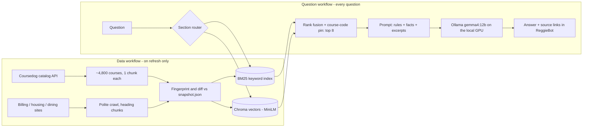
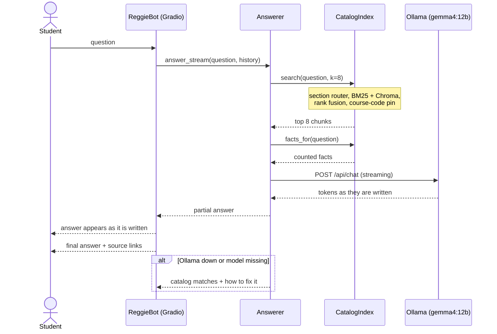
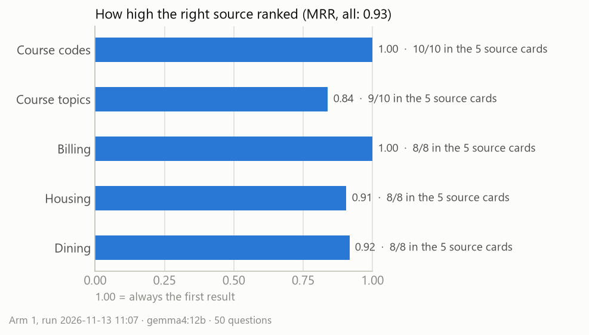

# ReggieBot — ISU Campus Assistant

A retrieval-augmented (RAG) chat assistant for Illinois State University. Ask about **courses, billing,
housing and dining**, and it answers only from ISU's own course catalog and websites, with a link to every
source. Answers are written by **Gemma 4 12B running locally through [Ollama](https://ollama.com)**, so
there is no API key, no quota and no per-question cost.

> Student project, not an official Illinois State University service. Answers can be wrong; check
> anything important with the university.

The program is **`ISU-CampusAssistant-RAG-Ollama.ipynb`**. The repo also holds the original Gemini version
(`ISU-CampusAssistant-RAG-Demo.ipynb`) and a notebook that compares the two (`ISU-CampusAssistant-Compare.ipynb`).

---

## Clone and run

### What you need

| | |
|---|---|
| Computer | Windows 10/11 (tested), macOS or Linux |
| GPU | NVIDIA with 10–12 GB of memory recommended (tested on an RTX 4070 Ti, 12 GB). Without one it still runs, slowly |
| Disk | About 15 GB free: the model is 8 GB, Python packages (PyTorch) most of the rest |
| Software | [Python 3.10+](https://www.python.org/downloads/) (tested on 3.12), [Git](https://git-scm.com/downloads), [VS Code](https://code.visualstudio.com/) with the **Python** and **Jupyter** extensions, [Ollama](https://ollama.com/download) |

### Steps

1. **Clone the repo** and open the folder in VS Code.
   ```bash
   git clone <this-repo-url>
   cd <repo-folder>
   ```
2. **Create a virtual environment and install the packages** (in VS Code's terminal):
   ```bash
   python -m venv .venv
   .venv\Scripts\activate          # Windows
   source .venv/bin/activate       # macOS / Linux
   pip install -r requirements.txt
   ```
3. **Install Ollama and download the model.** Install Ollama from [ollama.com/download](https://ollama.com/download)
   and start it (a llama icon appears in the system tray). Then, in a new terminal:
   ```bash
   ollama pull gemma4:12b
   ollama run gemma4:12b "Say ready"
   ```
   If the second command answers, Ollama works. The notebook sets the context length itself, so there is
   nothing else to configure in Ollama.
4. **API keys: none needed.** `.env.example` lists optional keys for the other notebooks; if you copy it to
   `.env`, never commit it (`.gitignore` already excludes it).
5. **Open `ISU-CampusAssistant-RAG-Ollama.ipynb`** and choose the `.venv` interpreter as the kernel
   (top-right of the notebook).
6. **Run All.** The first run crawls the ISU catalog and websites and builds the search index (about two
   minutes), because the saved data is not in the repo. After that, untick `REFRESH_DATA` in section 9 and
   the app starts from the saved data in seconds. The chat opens at **http://127.0.0.1:7860**.
7. **Optional — share it with 5–15 people:** see [Sharing](#sharing-with-515-people) below.

**Changing settings:** the model, `TOP_K`, the sites to crawl and sharing are all in `reggiebot/config.py`.
Edit a value there, then restart the notebook's kernel (or `app.py`).

**No suitable GPU?** Pull a smaller model (`ollama pull qwen3.5:4b`) and set `OLLAMA_MODEL = "qwen3.5:4b"` in
`reggiebot/config.py`. Answers get quicker on weak hardware, at some cost in quality.

### Try it without Ollama (test mode)

No graphics card, or no time for the 8 GB model download? Skip step 3 and double-click
`start_test_mode.bat` (or run `python app.py --fake`). Everything is real except the answers: the
search, the source links and the chat page all work, and each answer is an instant placeholder that lists
what the search found. The status line shows `RAG, fake` so nobody mistakes it for the real thing. For the
notebook, set `MODEL = "fake"` in `reggiebot/config.py` instead.

To check the answering logic, run the tests from the project folder. They need no Ollama and no saved data
and finish in a few seconds:

```bash
python -m unittest discover tests -v
```

The fake can also pretend Ollama failed, to see the fallback messages: `python app.py --model fake:offline`
(or `fake:missing`, `fake:busy`, `fake:broken`).

### Run it as an app (without VS Code)

Once the steps above work, you can start and stop ReggieBot without opening the notebook. `app.py` and the
notebook both use the `reggiebot/` package, so a change to the code or the settings shows up in both.

| To | Double-click | Or in a terminal |
|---|---|---|
| Start, on this PC only | `start_reggiebot.bat` | `python app.py` |
| Start with a public link for testers | `share_reggiebot.bat` | `python app.py --share` |
| Start in test mode (fake answers, no Ollama) | `start_test_mode.bat` | `python app.py --fake` |
| Stop | `stop_reggiebot.bat`, or close the app's window | `python app.py --stop` |
| See whether it is running, and its link | | `python app.py --status` |

More options: `--hours 3` stops it by itself after 3 hours, `--refresh` re-crawls the data before starting,
`--port 7861` uses another port, and `--no-browser` does not open the chat page.

While it runs, the app keeps the PC from going to sleep (the screen can still turn off) and starts Ollama if
it is not running. When it stops, it unloads the model from the graphics card and lets the PC sleep again,
so the computer is back to normal. Only one copy runs at a time; shut down the notebook's kernel first if
the notebook's chat app is running. Messages are also saved to `logs/reggiebot.log`.

### If something goes wrong

| Symptom | Fix |
|---|---|
| `ollama` is "not recognized" in the terminal | Close and reopen VS Code completely after installing Ollama |
| Chat says **"Ollama is not running"** | Start the Ollama app; the next question reconnects on its own |
| Chat says **"The model is not downloaded"** | `ollama pull gemma4:12b` |
| "No saved data … Run the crawler cell first" | Tick `REFRESH_DATA` in section 9 and run that cell |
| Answers are slow | Run the **Troubleshooting Ollama** cell (`ollama_report()`): it shows whether the model is fully on the GPU |
| Every answer takes ~2 s longer than it should | Keep `OLLAMA_URL` as `http://127.0.0.1:11434`; on Windows, `localhost` tries IPv6 first |

---

## How it works





The notebook's **Design** section has the full write-up: which components are **pre-determined** (touch
every question) and which are **probabilistic** (only in some scenarios), a cell that traces the route of any
question, the architecture diagram, the feature lists and the edge cases.

### Components at a glance

| Pre-determined — every question | Probabilistic — only when triggered |
|---|---|
| Gradio chat · BM25 search · MiniLM + Chroma search · rank fusion (top 8) · prompt builder · Ollama · source links | Section router (billing/housing/dining words) · course-code pin (a real code in the question) · counted facts (a subject code) · conversation history (follow-ups) · retry (timeout) · catalog-matches fallback (Ollama down) · reconnect · TF-IDF search (MiniLM unavailable) · crawler (refresh only) |

---

## Features

**Must-have — delivered**

1. Grounded answers about ISU courses, billing, housing and dining, from ISU's own data only
2. Hybrid retrieval: BM25 + Chroma, rank fusion, course-code pin, section router
3. Source links under every answer
4. Declines instead of inventing (missing courses, data behind a login, off-topic questions)
5. Free, local generation with Ollama: no key, no quota
6. Keeps working when parts fail: cached data offline, catalog matches when Ollama is down
7. Change detection: added / removed / updated courses, incremental re-indexing
8. ReggieBot chat in Illinois State colors, with starter questions
9. Built-in evaluation: retrieval and answer metrics, manual grading, speed and cost report
10. Limited public sharing: link, queue, anonymous usage count

**Top 3 nice-to-have**

1. Thumbs up / down feedback in the chat, saved for evaluation
2. A prerequisite planner that reasons over prerequisite chains
3. Always-on hosting with a scheduled nightly refresh

## Where it will not answer

Courses that do not exist, anything behind a login (balances, housing assignments, grades), live
registration data (seats, times, instructors), future or unpublished prices, off-topic questions,
prerequisite-chain reasoning, and pages that were never crawled. In each case it says so rather than guess.
The notebook's **Edge cases** table lists all of them, and a cell runs a sample.

---

## Experimental evaluation: Arm 1, the assistant as built

**Arm 1 is the baseline.** It measures the assistant exactly as built, on a fixed set of 50 questions, so that each
later arm can change one thing and be compared against these numbers. Every question goes through the same search
and answer functions the chat uses (notebook section 13).

- **The questions:** 50 in total:
  - 10 asking about a course by its code
  - 10 asking about a course topic
  - 8 billing, 8 housing and 8 dining
  - 6 "trap" questions that the data cannot answer, such as an account balance or a course that doesn't exist

  Each question has a rule for what counts as the right source: a course code, or a website section plus key phrases.
- **Three layers of evaluation:**
  - **retrieval:** did the right source reach the model?
  - **automatic answer checks:** did it answer, cite the expected source, link websites, and decline the traps?
  - **manual grading:** is the answer actually correct?
- **Held fixed for later arms:** the saved data, the questions, the top 8 chunks, the MiniLM embeddings and
  `gemma4:12b`.

### Results

Run on 2026-11-13 with `gemma4:12b` on an RTX 4070 Ti, over ISU's catalog and websites as saved on 2026-11-06
(6,797 chunks).



| Measure | Result |
|---|---|
| Right source among the 8 chunks given to the model | 44/44 (100%) |
| Right source among the 5 source cards a user sees | 43/44 (98%), MRR 0.93 |
| Billing, housing and dining questions routed to their own section | 20/24 (83%) |
| Model wrote an answer (no fallback) | 50/50 (100%) |
| Answer names the expected course or links the expected site | 44/44 (100%) |
| Website answers that include a source link | 24/24 (100%) |
| Trap questions declined instead of answered | 6/6 (100%) |
| Manual grading (correct / partial / wrong) | In progress: graded in section 13 |

**Repeatable:** a first run on 2026-10-19 gave exactly the same scores. The search is exact, so the same question
returns the same sources every run. The model's wording can vary slightly between runs (temperature 0.2).

### What went wrong

- **One source ranked below the visible cards.** For T09, "Classes about teaching children to read", the right
  course came 7th, below the 5 source cards. The top three were children's *literature* courses: the words
  "children" and "read" matched them more strongly than the literacy and reading-instruction courses.
- **Four questions were not routed to their section:**
  - B06 (a 1098-T tax form)
  - B08 (student health insurance)
  - H05 (Cardinal Court)
  - D07 (a dietitian)

  The keyword router has no keyword for these topics. The search still found the right page among the top 8 for
  all four, so the answers were not affected.
- **The automatic checks are text matches.** They catch a missing source but not a wrong fact. The manual grades
  are the authority on correctness.

### Demo

- **In the notebook:**
  - Section 13's demo cell answers one question from each category. It shows where the right source ranked, how
    long the answer took, and the source links.
  - Section 13 also runs all 50 questions and draws the chart.
- **In the chat:** start the assistant (section 10, or `start_reggiebot.bat`) and ask any of the Arm 1 questions.

### Speed and cost

| Speed (10-question sample) | Median | 90th percentile |
|---|---|---|
| Time to first token (search included) | 0.7 s | 0.9 s |
| Full answer | 2.3 s | 4.9 s |
| Search (BM25 + vector) | 0.03 s | |
| Generation speed | 122 tokens/s | |

| Cost | |
|---|---|
| API | $0: no key, no quota |
| Electricity (upper-bound estimate: 285 W for the whole answer at $0.16/kWh) | about $0.00003 per answer, $0.03 per 1,000 answers |
| Hardware | Needs a capable GPU for these speeds; that is the real cost of running locally |

The raw results are in `isu_catalog_cache/experiments/arm1_ollama/`:
- `results.csv`, one row per question
- `summary.json`
- the write-up, `arm1_writeup.md`

Speed is in `performance_ollama.json`. `ISU-CampusAssistant-Compare.ipynb` runs the same questions through Gemini
as well, with blind grading.

---

## Sharing with 5–15 people

1. Double-click `share_reggiebot.bat`, or set `SHARE_LINK = True` in `reggiebot/config.py` and Run All in the notebook.
2. Send testers the public `https://….gradio.live` link it prints. There is no login: anyone with the link can
   use it, so share it only with the people you want.
3. Keep the PC, Ollama and the notebook running. One answer is written at a time (`MAX_CONCURRENT = 1`)
   and up to 20 people wait in line (`MAX_QUEUE`). With answers around 2 s, 15 people asking at once wait
   about 30 seconds at worst.
4. Section 15's `usage_summary()` counts questions and browser sessions from
   `isu_catalog_cache/experiments/usage_log.csv`. Each row has the time, an anonymous session id, the
   status, the speed, the retries and the model. It stores no question text.

## Repository layout

| Path | What it is |
|---|---|
| `reggiebot/` | **The program**, as a Python package: `config.py` (every setting), `collect.py` (catalog API, crawler, change detection), `index.py` (hybrid search), `answer.py` (Ollama answers), `core.py` (app state), `ui.py` (chat page) |
| `ISU-CampusAssistant-RAG-Ollama.ipynb` | Explains and runs the program: each stage, the design write-up, evaluation, speed and cost, sharing |
| `app.py` | Runs the program without VS Code; start, stop, status, timer |
| `start_reggiebot.bat` · `share_reggiebot.bat` · `start_test_mode.bat` · `stop_reggiebot.bat` | Double-click shortcuts for `app.py` on Windows |
| `start_emulator.bat` · `stop_emulator.bat` | Double-click to try the Android app in the emulator on this PC (starts the app's test server, the virtual phone and the app; needs Ollama running), and to close it all |
| `tests/` | Answerer tests using the fake model: `python -m unittest discover tests -v` |
| `CHANGES.md` | What changed in the Ollama and Space notebooks, and why |
| `ISU-CampusAssistant-RLHF.ipynb` | RLHF stage 1: rate a short answer (A) against a detailed one (B), both from ReggieBot's saved sources; a small reward head learns your preference and picks the style for new questions |
| `ISU-CampusAssistant-RAG-Space.ipynb` · `space_app.py` · `reggiebot/hf_model.py` | The Hugging Face Space edition: Gemma 4 loaded with transformers on ZeroGPU, for a permanent public address. The notebook tests it, builds `space_build/` and uploads it |
| `ISU-CampusAssistant-Android.ipynb` · `android_space_app.py` · `android_app/` | **Campus Assistant ISU (unofficial)**, the Android app for Google Play. `android_space_app.py` is its server on a second Hugging Face Space (the Space edition plus `ask`, `report` and `status` endpoints); `android_app/` is the Kotlin app. The notebook tests the server, uploads it, installs the Android build tools on D:, builds and tests the app, and prepares the store listing. See `README-Android-app.md` |
| `ISU-CampusAssistant-RAG-Demo.ipynb` | The same assistant answering with Google Gemini (needs `GOOGLE_API_KEY`) |
| `ISU-CampusAssistant-Compare.ipynb` | Gemini vs Ollama on the same 50 questions, with blind grading |
| `requirements.txt` | Python packages |
| `.env.example` | Template for `.env` (optional settings and keys) |
| `isu_catalog_cache/experiments/` | Saved evaluation results; the rest of the cache is rebuilt by the crawler |
| `docs/` | Images shown in this README: the Arm 1 results chart, kept up to date by the chart cell in section 13 |
