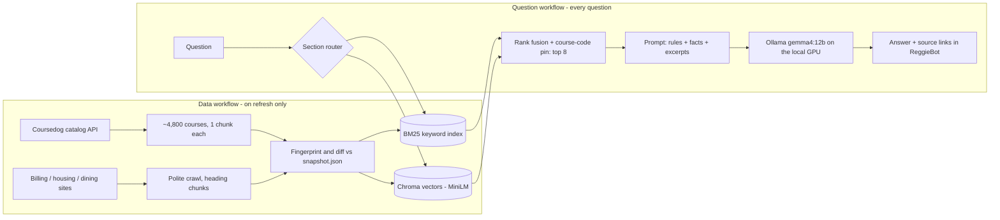
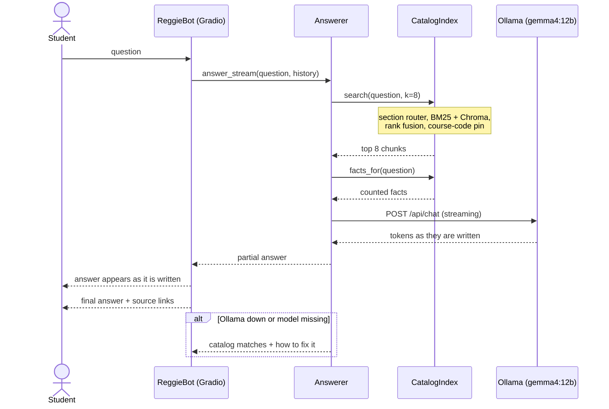

# ReggieBot — ISU Campus Assistant

A retrieval-augmented (RAG) chat assistant for Illinois State University. Ask about **courses, billing,
housing and dining**, and it answers only from ISU's own course catalog and websites, with a link to every
source. Answers are written by **Gemma 4 12B running locally through [Ollama](https://ollama.com)**, so
there is no API key, no quota and no per-question cost.

> Student project, not an official Illinois State University service. Answers can be wrong; check
> anything important with the university.

The program is **`ISU-CampusAssistant-RAG-Ollama.ipynb`**. The repo also holds the original Gemini version
(`ISU-CampusAssistant-RAG-Demo.ipynb`) and a notebook that compares the two (`ISU-CampusAssistant-Compare.ipynb`).

---

## Clone and run

### What you need

| | |
|---|---|
| Computer | Windows 10/11 (tested), macOS or Linux |
| GPU | NVIDIA with 10–12 GB of memory recommended (tested on an RTX 4070 Ti, 12 GB). Without one it still runs, slowly |
| Disk | About 15 GB free: the model is 8 GB, Python packages (PyTorch) most of the rest |
| Software | [Python 3.10+](https://www.python.org/downloads/) (tested on 3.12), [Git](https://git-scm.com/downloads), [VS Code](https://code.visualstudio.com/) with the **Python** and **Jupyter** extensions, [Ollama](https://ollama.com/download) |

### Steps

1. **Clone the repo** and open the folder in VS Code.
   ```bash
   git clone <this-repo-url>
   cd <repo-folder>
   ```
2. **Create a virtual environment and install the packages** (in VS Code's terminal):
   ```bash
   python -m venv .venv
   .venv\Scripts\activate          # Windows
   source .venv/bin/activate       # macOS / Linux
   pip install -r requirements.txt
   ```
3. **Install Ollama and download the model.** Install Ollama from [ollama.com/download](https://ollama.com/download)
   and start it (a llama icon appears in the system tray). Then, in a new terminal:
   ```bash
   ollama pull gemma4:12b
   ollama run gemma4:12b "Say ready"
   ```
   If the second command answers, Ollama works. The notebook sets the context length itself, so there is
   nothing else to configure in Ollama.
4. **API keys: none needed.** Optionally copy `.env.example` to `.env` to set a password for sharing (step 7).
   Never commit `.env`; `.gitignore` already excludes it.
5. **Open `ISU-CampusAssistant-RAG-Ollama.ipynb`** and choose the `.venv` interpreter as the kernel
   (top-right of the notebook).
6. **Run All.** The first run crawls the ISU catalog and websites and builds the search index (about two
   minutes), because the saved data is not in the repo. After that, untick `REFRESH_DATA` in section 9 and
   the app starts from the saved data in seconds. The chat opens at **http://127.0.0.1:7860**.
7. **Optional — share it with 5–15 people:** see [Sharing](#sharing-with-515-people) below.

**No suitable GPU?** Pull a smaller model (`ollama pull qwen3.5:4b`) and set `OLLAMA_MODEL = "qwen3.5:4b"` in
the config cell. Answers get quicker on weak hardware, at some cost in quality.

### If something goes wrong

| Symptom | Fix |
|---|---|
| `ollama` is "not recognized" in the terminal | Close and reopen VS Code completely after installing Ollama |
| Chat says **"Ollama is not running"** | Start the Ollama app; the next question reconnects on its own |
| Chat says **"The model is not downloaded"** | `ollama pull gemma4:12b` |
| "No saved data … Run the crawler cell first" | Tick `REFRESH_DATA` in section 9 and run that cell |
| Answers are slow | Run the **Troubleshooting Ollama** cell (`ollama_report()`): it shows whether the model is fully on the GPU |
| Every answer takes ~2 s longer than it should | Keep `OLLAMA_URL` as `http://127.0.0.1:11434`; on Windows, `localhost` tries IPv6 first |

---

## How it works





The notebook's **Design** section has the full write-up: which components are **pre-determined** (touch
every question) and which are **probabilistic** (only in some scenarios), a cell that traces the route of any
question, the architecture diagram, the feature lists and the edge cases.

### Components at a glance

| Pre-determined — every question | Probabilistic — only when triggered |
|---|---|
| Gradio chat · BM25 search · MiniLM + Chroma search · rank fusion (top 8) · prompt builder · Ollama · source links | Section router (billing/housing/dining words) · course-code pin (a real code in the question) · counted facts (a subject code) · conversation history (follow-ups) · retry (timeout) · catalog-matches fallback (Ollama down) · reconnect · TF-IDF search (MiniLM unavailable) · crawler (refresh only) |

---

## Features

**Must-have — delivered**

1. Grounded answers about ISU courses, billing, housing and dining, from ISU's own data only
2. Hybrid retrieval: BM25 + Chroma, rank fusion, course-code pin, section router
3. Source links under every answer
4. Declines instead of inventing (missing courses, data behind a login, off-topic questions)
5. Free, local generation with Ollama: no key, no quota
6. Keeps working when parts fail: cached data offline, catalog matches when Ollama is down
7. Change detection: added / removed / updated courses, incremental re-indexing
8. ReggieBot chat in Illinois State colors, with starter questions
9. Built-in evaluation: retrieval and answer metrics, manual grading, speed and cost report
10. Limited public sharing: link, optional password, queue, anonymous usage count

**Top 3 nice-to-have**

1. Thumbs up / down feedback in the chat, saved for evaluation
2. A prerequisite planner that reasons over prerequisite chains
3. Always-on hosting with a scheduled nightly refresh

## Where it will not answer

Courses that do not exist, anything behind a login (balances, housing assignments, grades), live
registration data (seats, times, instructors), future or unpublished prices, off-topic questions,
prerequisite-chain reasoning, and pages that were never crawled. In each case it says so rather than guess.
The notebook's **Edge cases** table lists all of them, and a cell runs a sample.

---

## Evaluation, cost, reliability and speed

Output is evaluated in three layers (notebook section 13): **retrieval** (did the right source reach the
model?), **automatic answer checks** (did it answer, cite the expected source, link websites, decline trap
questions?) and **manual grading** (is it actually correct?). Speed and cost are measured in section 14.

Measured on 2026-10-19 with `gemma4:12b` on an RTX 4070 Ti, over the 50 Arm 1 questions (10 course-code,
10 course-topic, 8 billing, 8 housing, 8 dining, 6 trap):

| Reliability | Result |
|---|---|
| Right source among the 8 chunks given to the model | 44/44 (100%) |
| Right source among the 5 source cards a user sees | 43/44 (98%), MRR 0.93 |
| Billing / housing / dining questions routed to their own section | 20/24 (83%) |
| Model wrote an answer (no fallback) | 50/50 (100%) |
| Answer names the expected course or links the expected site | 44/44 (100%) |
| Website answers that include a source link | 24/24 (100%) |
| Trap questions declined instead of answered | 6/6 (100%) |
| Manual grading (correct / partial / wrong) | Pending: grade in section 13 |

| Speed (10-question sample) | Median | 90th percentile |
|---|---|---|
| Time to first token (search included) | 0.9 s | 1.0 s |
| Full answer | 2.2 s | 4.0 s |
| Search (BM25 + Chroma) | 0.04 s | |
| Generation speed | 132 tokens/s | |

| Cost | |
|---|---|
| API | $0: no key, no quota |
| Electricity (upper-bound estimate: 285 W for the whole answer at $0.16/kWh) | about $0.00003 per answer, $0.03 per 1,000 answers |
| Hardware | Needs a capable GPU for these speeds; that is the real cost of running locally |

The automatic checks are text matches, so they catch missing sources but not wrong facts; the manual grades
are the authority on correctness. Raw results are in `isu_catalog_cache/experiments/arm1_ollama/` and
`performance_ollama.json`. `ISU-CampusAssistant-Compare.ipynb` runs the same questions through Gemini as
well, with blind grading.

---

## Sharing with 5–15 people

1. Add `APP_PASSWORD=pick-something` to `.env` (testers log in as `isu`).
2. In the config cell, set `SHARE_LINK = True`.
3. Run All. Section 10 prints a public `https://….gradio.live` link; send it with the login.
4. Keep the PC, Ollama and the notebook running. One answer is written at a time (`MAX_CONCURRENT = 1`)
   and up to 20 people wait in line (`MAX_QUEUE`). With answers around 2 s, 15 people asking at once wait
   about 30 seconds at worst.
5. Section 15's `usage_summary()` counts questions and browser sessions from
   `isu_catalog_cache/experiments/usage_log.csv`. It stores no question text.
 Link - https://59faa7bf3f1c7c6d30.gradio.live/

## Repository layout

| Path | What it is |
|---|---|
| `ISU-CampusAssistant-RAG-Ollama.ipynb` | **The program**: collect, index, answer, chat, design, evaluation, sharing |
| `ISU-CampusAssistant-RAG-Demo.ipynb` | The same assistant answering with Google Gemini (needs `GOOGLE_API_KEY`) |
| `ISU-CampusAssistant-Compare.ipynb` | Gemini vs Ollama on the same 50 questions, with blind grading |
| `requirements.txt` | Python packages |
| `.env.example` | Template for `.env` (optional settings and keys) |
| `isu_catalog_cache/experiments/` | Saved evaluation results; the rest of the cache is rebuilt by the crawler |
